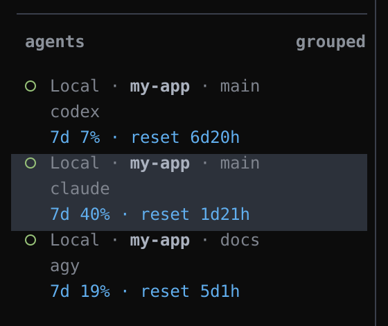

# herdr-week-quota

在 [Herdr](https://herdr.dev) 的 Agent 侧边栏里显示**本周已用额度**，Windows 可用。

Show each agent's weekly quota used in Herdr's Agent sidebar, on Windows.



<sub>示意图，工作区名和数字都是演示数据。</sub>

每个 agent 下方多出一行：`7d` 表示 7 天周期，后面是**已用**百分比，`reset` 是距离重置还剩多久。

## 支持的 agent

| Agent | 数据来源 | 需要额外配置 |
| --- | --- | --- |
| Codex | 会话记录 `~/.codex/sessions/**/rollout-*.jsonl` 里最新的 `rate_limits`（7 天窗口） | 不需要 |
| Claude Code | 状态栏输入里的 `rate_limits.seven_day` | 需要配置状态栏脚本 `statusline/claude.js` |
| Antigravity CLI (agy) | 状态栏输入里的 `quota`：取当前模型所在的周额度池（`gemini-weekly` / `3p-weekly`），以及名字里带模型名的专属周额度池（例如 `gemini-argon-wtu-weekly`），显示用得最多的那一个 | 需要配置状态栏脚本 `statusline/agy.js` |

所有数据都在本地读取，不调用任何外部接口，也不读取任何凭据。拿不到数据，或者周期已经重置但还没有新读数时，这一行会隐藏，不会显示错误的数字。

## 工作原理

```
Claude 状态栏 ─┐
               ├─> %LOCALAPPDATA%\herdr-week-quota\{claude,agy}\*.json ─┐
agy 状态栏 ────┘                                                        ├─> week_quota.py（每 15 秒）
Codex rollout JSONL ────────────────────────────────────────────────────┘        │
                                                         herdr pane report-metadata --token week_used=...
                                                                                 │
                                                       config.toml 里的 $week_used 行显示到侧边栏
```

- `bin/week_quota.py`：常驻的后台进程，同一时间只会跑一个。它通过 `herdr` 命令行和 Herdr 交互（Windows 版 Python 不支持 Unix socket），Herdr 退出后自己结束。
- 只有数值变化时才会上报，不会反复刷新。

## 安装

需要：Windows、Herdr 0.8.0+、Python 3.10+（命令名为 `python`）、Node.js（用来跑状态栏脚本）。

1. 安装插件：

   ```sh
   herdr plugin install heloka/herdr-week-quota
   ```

   或者克隆到本地后用 `herdr plugin link <目录>` 链接。

2. 在 `%APPDATA%\herdr\config.toml` 的 Agent 侧边栏布局里加一行，然后运行 `herdr server reload-config`：

   ```toml
   [ui.sidebar.agents]
   rows = [
     ["state_icon", "machine", "workspace", "tab"],
     ["agent"],
     [{ token = "$week_used", fg = "#61afef" }],
   ]
   ```

   如果你已经有自定义的 `rows`，只需在里面追加最后这一行。颜色可以随意改，`#61afef` 是 one-dark 主题里的蓝色。

3. Claude Code：把 `statusline/claude.js` 复制到 `~/.claude/`，然后在 `~/.claude/settings.json` 里加上：

   ```json
   "statusLine": { "type": "command", "command": "node C:/Users/<you>/.claude/claude.js" }
   ```

   如果你已经有自己的状态栏脚本，把 `claude.js` 里写入 `rate_limits` 的那一段合并进去就行。

4. agy：把 `statusline/agy.js` 复制到 `~/.gemini/antigravity-cli/`，然后在 `~/.gemini/antigravity-cli/settings.json` 里加上：

   ```json
   "statusLine": { "type": "command", "command": "node C:/Users/<you>/.gemini/antigravity-cli/agy.js", "enabled": true }
   ```

   **注意**：agy 在 Windows 上执行命令时，会把引号原样传下去。所以路径里不要加引号，也不要带空格。agy 的状态栏连续失败 30 次后会被自动关闭（`"enabled": false`），修好命令后需要把它改回 `true`。

Claude 和 agy 需要先回复一轮、状态栏刷新过一次之后，侧边栏才会显示。

## 命令

```sh
herdr plugin action invoke herdr-week-quota.refresh   # 立即刷新一次
```

## 致谢

- [hphsu/herdr-agent-quota](https://github.com/hphsu/herdr-agent-quota)（MIT）：本插件的 Claude/agy 状态栏取数方式参考了它，它支持更多 agent，但只能在 macOS/Linux 上运行。
- [pdalinis/herdr-ctx-bar](https://github.com/pdalinis/herdr-ctx-bar)（MIT）：插件结构参考了它。

## License

[MIT](LICENSE)
